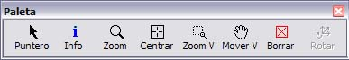

# Barra de herramientas Paleta
<!-- id: barra-de-herramientas-paleta -->

Esta barra de herramientas está destinada para elegir herramientas de visualización o tratamiento de las entidades del archivo de croquis actual. Estas herramientas son excluyentes, es decir, sólo puede estar elegida una en cada momento y su elección cambia el tipo de cursor. Aparecen los siguientes comandos:

*  **Puntero**: Se elegirá esta opción por defecto, la cual no tiene ninguna función específica.
*  **Info**: Herramienta para ofrecer información acerca del elemento seleccionado. Pulse el botón izquierdo para seleccionar el elemento deseado y vuelva a pulsarlo para confirmar la selección. Pulse el botón derecho para deseleccionarlo o para buscar otro elemento en la misma localización.
*  **Zoom**: Seleccione esta opción para cambiar la escala de visualización del croquis. El botón izquierdo aumenta la escala y el botón derecho la reduce. Esta herramienta puede ser seleccionada manteniendo pulsada la tecla \[CTRL\]. Igualmente, se puede acercar o alejar la vista del documento actual pulsando las teclas \[AV PAG\] y \[RE PAG\], respectivamente. Una última forma de ejecutar este comando es con la rueda central del ratón, si se dispone de ella.
*  **Centrar**: Esta opción centra la vista sobre un punto.
*  **Zoom V**: Con esta opción se ajusta la visualización a una ventana deseada, seleccionada con el botón izquierdo del ratón.
*  **Mover V**: Con esta opción se puede mover la visualización en tiempo real, pulsando el botón izquierdo sin soltar y moviendo el ratón. Esta herramienta puede ser seleccionada manteniendo pulsada la tecla \[ESPACIO\].
*  **Borrar**: Con esta opción se pueden borrar elementos del dibujo. Esta herramienta puede ser seleccionada pulsando la tecla \[SUPR\].

Al pulsar la tecla \[ESC\] se selecciona el comando *Puntero*, que no tiene funcionalidad.

