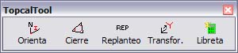
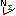
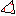
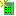

# Barra de herramientas TopcalTool
<!-- id: barra-de-herramientas-topcaltool -->

Esta barra de herramientas contiene herramientas de cálculo topográfico básicas, como son:

*  [Orienta](../herramientas/calculo-de-desorientaciones/README.md): Permite calcular la desorientación de un punto en base a observaciones a otros puntos de coordenadas conocidas. Esta opción sólo estará habilitada si se tiene activo un proyecto.
*  [Cierre](../herramientas/cierre-de-triangulos/README.md): Permite calcular los cierres de triángulos formados por un conjunto de observaciones realizadas entre puntos. Esta opción sólo estará habilitada si se tiene activo un archivo de observaciones. No es necesario tener archivos de puntos ni proyecto, por lo que únicamente será necesario tener seleccionado un archivo de observaciones.
*  [Replanteo](../herramientas/replanteo/README.md): Permite generar un archivo con las observaciones de ángulo y distancia que deben realizarse para situar puntos nuevos en el terreno, en la operación de replanteo. Esta opción sólo estará habilitada si se tiene activo un proyecto.
*  [Transfor.](../herramientas/transformacion/README.md): Transforma las coordenadas de un archivo de puntos al sistema de coordenadas definido por los puntos de otro archivo, utilizando los puntos comunes a ambos sistemas. Esta opción sólo estará habilitada si se tiene activo un proyecto.
*  [Libreta](../herramientas/generar-libreta-de-campo/README.md): Permite generar un archivo de observaciones a partir de las coordenadas conocidas de un conjunto de puntos. Esta opción sólo estará habilitada si se tiene activo un proyecto.

