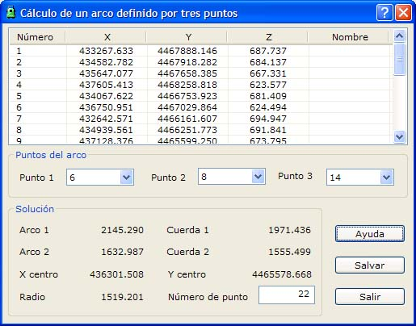

# Arco definido por tres puntos
<!-- id: arco-definido-por-tres-puntos -->

Con esta herramienta se puede calcular el arco definido por tres puntos almacenados en el fichero de puntos. Para llamar a esta herramienta se debe tener activo un fichero de puntos. Los campos que se muestran en el cuadro de diálogo son los siguientes:

* **Listado de puntos**: Listado de puntos del fichero actual.
* **Punto 1**: Se deberá seleccionar de la lista el primer punto del arco.
* **Punto 2**: Se deberá seleccionar de la lista el segundo punto del arco.
* **Punto 3**: Se deberá seleccionar de la lista el tercer punto del arco.
* **Solución**: Se muestran las dos soluciones posibles:
  * **Arco 1**: Arco en metros de la primera solución
  * **Arco 2**: Arco en metros de la segunda solución
  * **Cuerda 1**: Cuerda en metros de la primera solución
  * **Cuerda 2**: Cuerda en metros de la segunda solución
  * **X centro**: Coordenada X del centro del arco
  * **Y centro**: Coordenada Y del centro del arco
  * **Radio**: Radio del arco
  * **Número de punto**: Número del nuevo punto

Una vez que se haya calculado el arco, pulsando el botón **Salvar**, se podrá salvar en el fichero de puntos el centro de dicho arco, con el número de punto señalado en el campo **Número de punto**.

