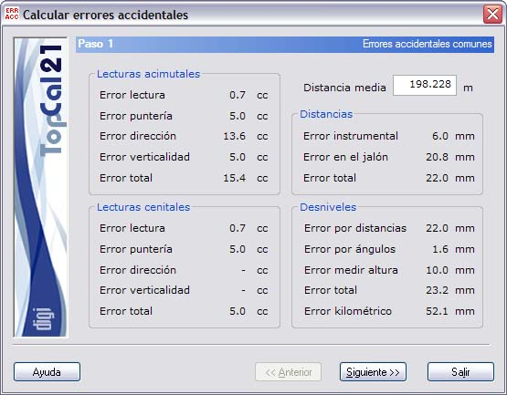

# Paso 1: Errores accidentales comunes
<!-- id: topcal21-calculo-de-errores-accidentales-paso-1-errores-accidentales-comunes -->

Este es el primer paso para calcular los errores accidentales. Este paso está destinado a conocer los errores accidentales comunes que se producen en función del tipo de observación (acimutal, cenital, distancia o desnivel) a partir de las características del instrumental y una distancia, que puede cambiar el usuario.

Se muestra una pantalla donde se debe introducir la distancia con la que calcular los errores accidentales que acaecen en los diferentes tipos de observaciones. Inicialmente, se mostrará la **distancia media** de todas las observaciones del archivo de observaciones actual. Los errores accidentales que se muestran son los siguientes:

* **Lecturas acimutales**:
  * *Error de lectura*: Error producido al leer el valor de la lectura del ángulo en el instrumental. Depende de la apreciación angular del instrumental.
  * *Error de puntería*: Error al hacer la puntería sobre el prisma. Depende de los aumentos en la óptica del instrumental.
  * *Error de dirección*: Error debido a la falta de precisión en la señalización de la estación y el punto visado. Esta precisión se indica en las [propiedades del documento de observaciones](../../opciones-de-visualizacion/propiedades-de-los-objetos/propiedades-del-archivo-de-visuales.md).
  * *Error de verticalidad*: Error debido a la falta de verticalidad del instrumental. Depende de la precisión de nivel tubular del instrumental.
  * *Error total*: Componente cuadrática de los errores anteriores.
* **Lecturas cenitales**:
  * *Error de lectura*: Error producido al leer el valor de la lectura del ángulo en el instrumental. Depende de la apreciación angular del instrumental.
  * *Error de puntería*: Error al hacer la puntería sobre el prisma. Depende de los aumentos en la óptica del instrumental.
  * *Error de dirección*: No influye en las lecturas cenitales.
  * *Error de verticalidad*: No influye en las lecturas cenitales.
  * *Error total*: Componente cuadrática de los errores anteriores.
* **Distancias**:
  * *Error instrumental*: Error producido al medir la distancia, que depende de la precisión del distanciómetro.
  * *Error en el jalón*: Error producido por la inclinación del jalón. Depende de la altura de mira media.
  * *Error total*: Componente cuadrática de los errores anteriores.
* **Desniveles**:
  * *Error por distancias*: Error producido por la precisión en la medida de las distancias. Depende de la precisión del distanciómetro.
  * *Error por ángulos*: Error producido por la precisión en la medida de los ángulos cenitales, mostrado anteriormente.
  * *Error medir altura*: Error producido en la medida de la altura del instrumento y del prisma. Se valora en 10 mm.
  * *Error total*: Componente cuadrática de los errores anteriores.
  * *Error kilométrico*: Error total expresado en formato de error por cada 1000 m de observación. De esta forma, se puede comparar la precisión alcanzada por una nivelación trigonométrica con la precisión de una nivelación geométrica, la cual se expresa de esta forma.

Este paso sólo es de información, no es necesario seleccionar nada, por lo que se puede pulsar al botón **Siguiente** para acceder al [Paso 2: Errores en métodos y salida de datos.](paso-2-errores-en-metodos-y-salida-de-datos.md)
