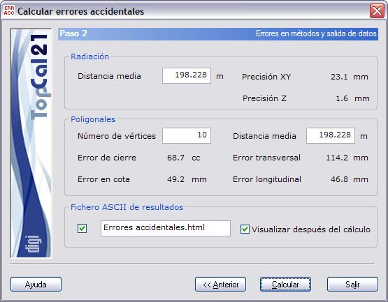

# Paso 2: Errores en métodos y salida de datos
<!-- id: topcal21-calculo-de-errores-accidentales-paso-2-errores-en-metodos-y-salida-de-datos -->

Este es el segundo y último paso para el cálculo de errores accidentales. Este paso está destinado a analizar los errores que se producirán en el método de la radiación y en el método de poligonación en función de unas características de observación. De esta forma, se podrá elegir un instrumental diferente o unas características de observación diferentes si no se alcanzan a priori las precisiones deseadas.

Se muestran los siguientes campos:

* **Radiación**:
  * *Distancia media*: Se podrá indicar un valor de la distancia media en metros. Inicialmente, se mostrará la distancia media de todas las observaciones del archivo de observaciones actual.
  * *Precisión XY*: Precisión planimétrica alcanzada en el punto visado.
  * *Precisión Z*: Precisión altimétrica alcanzada en el punto visado.
* **Poligonales**:
  * *Número de vértices*: Número de vértices de la poligonal. A mayor número de vértices, menor precisión.
  * *Distancia media*: Se podrá indicar un valor de la distancia media en metros. Inicialmente, se mostrará la distancia media de todas las observaciones del archivo de observaciones actual.
  * *Error de cierre*: Error de cierre angular máximo de la poligonal.
  * *Error transversal*: Error planimétrico debido a la precisión angular.
  * *Error longitudinal*: Error planimétrico debido a la precisión en las distancias.
  * *Error en cota*: Error altimétrico de la poligonal.

Además, habrá que indicar el **fichero ASCII con los resultados** del cálculo. Este archivo podrá ser del formato html o de formato ASCII. Si la extensión de este archivo es HTM o html se tomará como formato html y en caso contrario se tomará como formato ASCII. Este archivo se podrá visualizar (con el visor que se hubiese indicado en el cuadro de [Preferencias](../../opciones-de-visualizacion/preferencias.md) del [menú Editar](../../menus-de-la-aplicacion/menu-editar.md)) si se activa la casilla inferior denominada **Visualizar después del cálculo**.

Si no se desea crear este archivo, se deberá desactivar la casilla que aparece a la izquierda del nombre. El archivo de resultados se creará en el directorio del proyecto, si existe, o en el directorio del archivo de observaciones actual.

Una vez que se hayan configurado los datos de salida, se podrá terminar el proceso pulsando el botón **Calcular** o volver al paso anterior [Paso 1: Errores accidentales comunes](paso-1-errores-accidentales-comunes.md) pulsando el botón **Anterior**.
