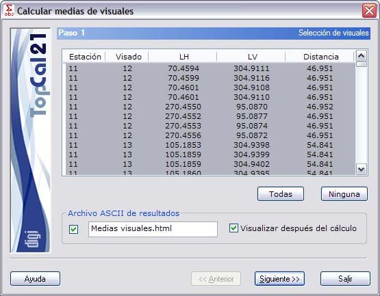

# Paso 1: Selección de visuales
<!-- id: topcal21-calculo-de-medias-de-visuales-paso-1-seleccion-de-visuales -->

Este es el primer paso para calcular las medias de las visuales.

Se muestra una pantalla con todas las visuales del archivo dispuestas en un listado en el que se muestran los siguientes campos:

* **Estación**
* **Visado**
* **Lectura horizontal**
* **Lectura vertical**
* **Distancia geométrica**

Se podrán seleccionar múltiples visuales utilizando la tecla *\[CTRL\]* y pulsando con el botón izquierdo del ratón sobre las visuales deseadas. Si pulsa una visual ya seleccionada, esa visual se deselecciona.

También se pueden seleccionar visuales dispuestas en rangos, pulsando la tecla *\[MAYÚSCULAS\]* y el botón izquierdo del ratón sobre las visuales límite que definen el rango.

De la misma forma, se pueden utilizar los botones de **Todas** o **Ninguna** para seleccionar o deseleccionar todas las visuales.

Además, habrá que indicar el **fichero ASCII con los resultados** del cálculo. Este archivo podrá ser del formato html o de formato ASCII. Si la extensión de este archivo es HTM o html se tomará como formato html y en caso contrario se tomará como formato ASCII. Este archivo se podrá visualizar (con el visor que se hubiese indicado en el cuadro de [Preferencias](../../opciones-de-visualizacion/preferencias.md) del [menú Editar](../../menus-de-la-aplicacion/menu-editar.md)) si se activa la casilla inferior denominada **Visualizar después del cálculo**.

Si no se desea crear este archivo, se deberá desactivar la casilla que aparece a la izquierda del nombre. El archivo se creará en el directorio del proyecto, si existe, o en el directorio del archivo de observaciones actual.

Una vez introducidos estos datos se podrá pulsar el botón **Siguiente** para acceder al [Paso 2: Desviaciones típicas](paso-2-desviaciones-tipicas.md).
