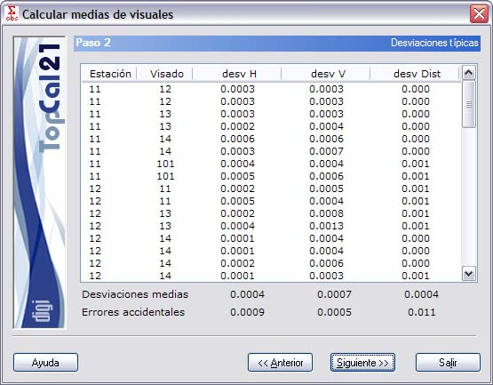

# Paso 2: Desviaciones típicas
<!-- id: topcal21-calculo-de-medias-de-visuales-paso-2-desviaciones-tipicas -->

Este es el segundo paso para el cálculo de las medias de visuales.

Se muestra una pantalla con las visuales seleccionadas en el paso anterior. El listado muestra las medias y las desviaciones típicas calculadas con esas visuales y contiene los siguientes campos:

* **Número de punto estación**
* **Número de punto visado**
* **Desviación típica en la media del ángulo horizontal**
* **Desviación típica en la media del ángulo vertical**
* **Desviación típica en la media de la distancia**

Debajo del listado de desviaciones típicas se muestra la **media** de las desviaciones típicas calculadas y los **errores accidentales** correspondientes (acimutal, cenital y en distancias) para poder hacer valoraciones acerca de la idoneidad de los resultados obtenidos.

Este paso sólo es de información, no es necesario seleccionar nada, por lo que se puede pulsar el botón **Siguiente** para acceder al [Paso 3: Configurar salida de datos](paso-3-configurar-salida-de-datos.md) o volver al [Paso 1: Selección de visuales](paso-1-seleccion-de-visuales.md) pulsando el botón **Anterior**.
