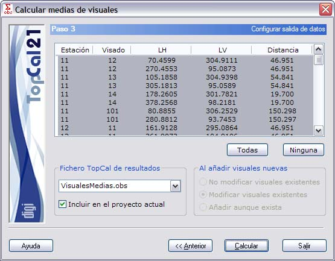

# Paso 3: Configurar salida de datos
<!-- id: topcal21-calculo-de-medias-de-visuales-paso-3-configurar-salida-de-datos -->

Este es el tercer y último paso para el cálculo de las medias de visuales.

Se muestran los siguientes campos:

* **Listado con las visuales medias**: Donde se indica el número de estación, número de punto visado, lectura horizontal, lectura vertical y distancia geométrica.
* **Fichero TopCal de resultados**: Se podrá seleccionar el nombre del fichero TopCal donde se almacenarán las visuales. Se podrá elegir alguno de los archivos existentes o generar un archivo nuevo. Si se desea generar un archivo nuevo, se podrá elegir añadir o no el fichero al proyecto actual. Seleccione un archivo de resultados diferente del archivo de entrada para evitar que se conserven las visuales repetidas.
* **Modo de añadir visuales**: Si el fichero de visuales no es nuevo se podrá elegir modificar o no las visuales con la misma estación y mismo visado que se encuentren en el fichero de salida elegido.

Una vez que se hayan configurado los datos de salida, se podrá terminar el proceso pulsando el botón **Calcular** o volver al paso anterior [Paso 2: Desviaciones típicas](paso-2-desviaciones-tipicas.md) pulsando el botón **Anterior**.
