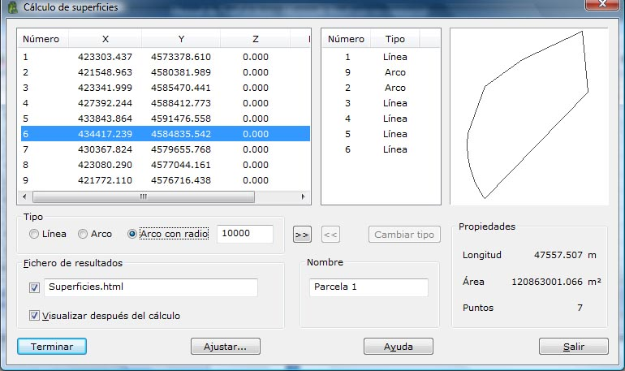

# Cálculo de superficies
<!-- id: calculo-de-superficies -->

Con esta herramienta se pueden calcular superficies a partir de los puntos que las definen y poder generar un gráfico con ellas. La definición de la superficie puede ser con tramos rectos o curvos. El cuadro de diálogo muestra los siguientes campos:

* **Listado de puntos**: Listado de puntos del fichero actual.
* **Listado de puntos que forman la superficie**: Para añadir puntos a este listado se deberán hacer doble clic con el botón izquierdo del ratón sobre el punto en el listado de la izquierda o pulsar el botón **>>**. Si se desea introducir un tramo curvo que parte desde un punto a otro, al añadir el primer punto se deberá seleccionar la opción **Arco** en el campo **Tipo**. No obstante, se puede seleccionar **Arco con radio** especificando éste en metros. El programa calculará en este caso un punto interior. Si el radio es positivo la curva será hacia la derecha y si es negativa es hacia la izquierda. El programa calculará automáticamente el radio del arco que pasa por dicho punto y los dos siguientes. El tipo de un punto perteneciente a una superficie también puede ser cambiado pulsando el botón **Cambiar tipo**. Si se desea eliminar algún punto de esta lista se deberá hacer doble clic con el botón izquierdo del ratón o pulsar el botón **&lt;&lt;**.
* **Nombre del fichero de salida**: Este fichero es un archivo ASCII con el resultado del cálculo y con un listado de los puntos que forman la superficie. Si se desea generar se deberá activar la casilla que aparece a la izquierda del nombre del archivo. Este archivo podrá ser del formato **html** o de formato **ASCII**. Si la extensión de este archivo es HTM o html se tomará como formato html y en caso contrario se tomará como formato ASCII. Este archivo se podrá visualizar (con el visor que se hubiese indicado en el cuadro de [Preferencias](../../opciones-de-visualizacion/preferencias.md) del menú [Editar](../../menus-de-la-aplicacion/menu-editar.md)) si se activa la casilla denominada **Visualizar después del cálculo**.
* **Nombre de la parcela**: Nombre de la parcela con el que aparecerá la superficie en el fichero de salida.
* **[Ajustar](ajustar-superficie.md)**: Pulsando este botón el programa permite modificar los puntos que definen una superficie para que ésta se ajuste a un valor de área.

Según se van introduciendo puntos el programa va calculando en tiempo real el área y el perímetro de la superficie.

Una vez que se ha concluido la definición se deberá pulsar el botón **Calcular** para [visualizar los datos](resultado-del-superficiado.md) o el botón **Salir** para salir del cuadro de diálogo.

