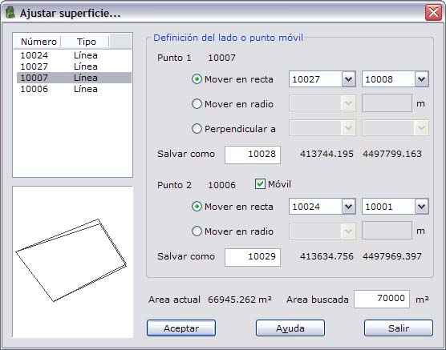

# Ajustar superficie
<!-- id: ajustar-superficie -->

Mediante esta herramienta el programa calcula los puntos que deben definir una superficie para que su área coincida con un valor proporcionado por el usuario. Para ello, el usuario deberá elegir qué punto o puntos se deben mover para que se cumpla tal condición.

Los campos mostrados y las opciones de movimiento disponibles son los siguientes:

* **Listado de puntos**: Se muestran los puntos que definen la superficie actual. En este listado se deberá seleccionar el primer punto que se va a mover. El segundo punto será elegido automáticamente y será el siguiente en esta definición.
* **Gráfico**: Se muestra un gráfico con la superficie actual y la superficie que se va calculando con los nuevos puntos.
* **Definición del punto 1**: Para poder ajustar el área de la superficie, el programa necesita mover por lo menos un punto. En este caso, se muestra el número de punto que se ha seleccionado en el listado de puntos. Además se muestran las opciones para recalcular el nuevo punto que son las siguientes:
  * **Mover en recta**: El punto nuevo calculado se deberá mover en la dirección de la recta definida por los puntos indicados.
  * **Mover en radio**: El punto nuevo calculado se deberá mover a una distancia fija del punto indicado.
  * **Perpendicular a**: El lado nuevo (punto 1 – punto 2) deberá ser perpendicular a la recta definida por los puntos indicados.

  Según se van modificando los parámetros el programa va calculando las nuevas coordenadas y, si llega a una solución, va mostrando las coordenadas a la derecha del número de punto nuevo. Al pulsar **Aceptar**, el programa inserta en el fichero de puntos el punto calculado con este número.
* **Definición del punto 2**: La herramienta permite mover dos puntos para el ajuste del área. Para ello habrá que activar el campo **Móvil**. Este campo se activará automáticamente en el caso de que el movimiento de los puntos sea perpendicular a un lado (opción 3 en la definición del punto 1). El número que se muestra corresponde con el punto siguiente al seleccionado del listado de puntos. Las opciones disponibles para recalcular el nuevo punto son las siguientes:
  * **Mover en recta**: El punto nuevo calculado se deberá mover en la dirección de la recta definida por los puntos indicados.
  * **Mover en radio**: El punto nuevo calculado se deberá mover a una distancia fija del punto indicado.

  Al igual que ocurre con el punto 1, según se van modificando los parámetros el programa va calculando las nuevas coordenadas y, si llega a una solución, va mostrando las coordenadas a la derecha del número de punto nuevo. Al pulsar **Aceptar**, el programa inserta en el fichero de puntos el punto calculado con este número.
* **Área actual**: Se muestra el valor del área en metros cuadrados de la superficie definida con los puntos iniciales.
* **Área buscada**: Se deberá indicar el valor del área buscada en metros cuadrados.

Para finalizar se podrá pulsar el botón **Aceptar** o salir de la herramienta pulsando el botón **Salir**. Al pulsar **Aceptar**, el programa añade los puntos nuevos calculados al fichero de puntos y modifica los puntos que definen la superficie para cumplir la condición de área impuesta.

