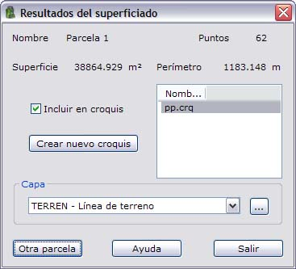

# Resultado del superficiado
<!-- id: resultado-del-superficiado -->

Aparte de los resultados obtenidos, en este cuadro de diálogo se puede elegir salvar la superficie como gráfico en un archivo de croquis. Para ello, se deberá haber llamado a la herramienta desde un archivo perteneciente a algún proyecto. En ese caso, el cuadro muestra los ficheros de croquis del proyecto actual. Si el proyecto no contiene ningún fichero de croquis, puede crear uno pulsando el botón **Crear nuevo croquis**. Si se decide incluir la superficie en un croquis se deberá seleccionar la capa en la que se registrará la entidad.

Para finalizar se podrá registrar **Otra parcela** o salir de la herramienta pulsando el botón **Salir**.

