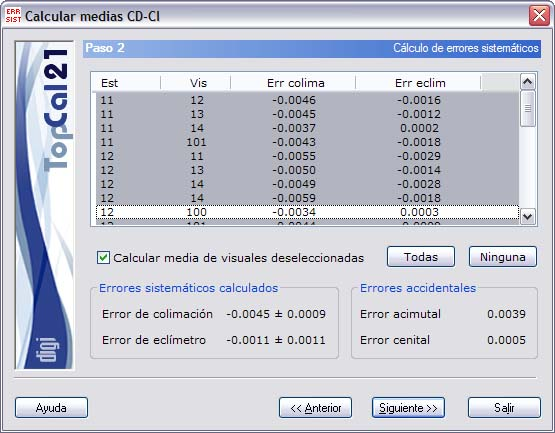

# Paso 2: Cálculo de errores sistemáticos
<!-- id: topcal21-calculo-medias-cd-ci-paso-2-calculo-de-errores-sistematicos -->

Este es el segundo paso para calculas las medias CD-CI y errores sistemáticos.

Se muestra una pantalla con las visuales seleccionadas en el paso anterior y con las que se han calculado los errores que se muestran en el listado.

El listado que se muestra contiene los siguientes campos:

* **Número de punto estación**
* **Número de punto visado**
* **Error de colimación**: Diferencia entre la lectura horizontal directa y la inversa.
* **Error de eclímetro**: Diferencia entre la lectura vertical directa y la inversa.

Se podrán seleccionar múltiples visuales utilizando la tecla *\[CTRL\]* y pulsando con el botón izquierdo del ratón sobre las visuales deseadas. Si se pulsa sobre una visual ya seleccionada, ésta se deselecciona.

También se pueden seleccionar visuales dispuestas en rangos, pulsando la tecla *\[MAYÚSCULAS\]* y el botón izquierdo del ratón sobre las visuales límite que definen el rango.

De la misma forma, se pueden utilizar los botones de **Todas** o **Ninguna** para seleccionar o deseleccionar todas las visuales.

En función de las visuales seleccionadas se calcularán simultáneamente la media de los errores, mostrándola en el campo **Errores sistemáticos calculados**. Seleccione o deseleccione visuales para recalcular esa media. El programa muestra también los **errores accidentales** acimutal y cenital como referencia para evaluar las visuales seleccionadas.

Si una visual es deseleccionada, el programa no calculará la media entre círculo directo y círculo inverso, a no ser que se active la casilla **Calcular medias de visuales deseleccionadas**.

Cuando se hayan seleccionado las visuales deseadas se puede pulsar el botón **Siguiente** para acceder al [Paso 3: Configurar salida de datos](paso-3-configurar-salida-de-datos.md) o volver al [Paso 1: Selección de visuales](paso-1-seleccion-de-visuales.md) pulsando el botón **Anterior**.
