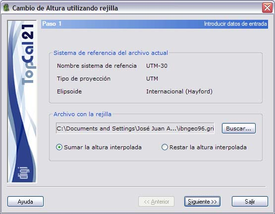

# Paso 1: Introducir datos de entrada
<!-- id: topcal21-cambio-de-altura-segun-rejilla-paso-1-introducir-datos-de-entrada -->

En el primer paso para el cambio de altura según rejilla, se muestran las características del sistema de referencia del archivo actual, el archivo que contiene la rejilla y el tipo de cálculo.

Se deberá indicar el archivo que contiene la rejilla y la manera de calcular con el valor interpolado, es decir, si se debe **sumar** o **restar** al valor de la cota de cada punto.

Una vez introducidos estos datos se podrá pulsar el botón **Siguiente** para acceder al [Paso 2: Selección de puntos](paso-2-seleccion-de-puntos.md).
