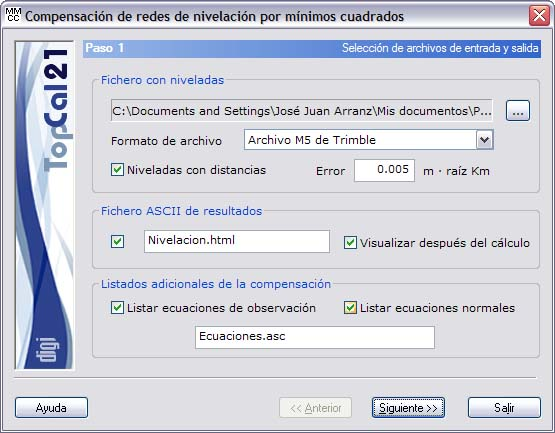

# Paso 1: Selección de archivos de entrada y salida
<!-- id: topcal21-compensacion-mmcc-de-red-de-nivelacion-paso-1-seleccion-de-archivos-de-entrada-y-salida -->

Este es el primer paso para calcular la compensación mínimo cuadrada de una red de nivelación. Los datos requeridos son los siguientes:

* **Fichero con niveladas**: En este campo se deberá indicar la ubicación del archivo que contiene las niveladas realizadas. El formato de este archivo podrá ser ASCII o formato M5 de niveles digitales Trimble. En el caso de formato ASCII, éste deberá estar compuesto por filas con las niveladas, donde la primera columna será el punto 1, la segunda columna será el punto 2, la tercera columna será el valor del desnivel en metros y la cuarta columna será la distancia entre los puntos en metros (esta columna es opcional). Si en cada nivelada se midió la distancia se podrá activar el campo **Niveladas con distancias** para poder ponderarlas en el cálculo, debiendo indicar el **error kilométrico** del nivel en metros.
* **Ficheros de resultados**: Se escribirá el nombre del fichero de salida con los resultados del cálculo. Este archivo podrá ser del formato **html** o de formato **ASCII**. Si la extensión de este archivo es HTM o html se tomará como formato html y en caso contrario se tomará como formato ASCII. Este archivo se podrá visualizar (con el visor que se hubiese indicado en el cuadro de [Preferencias](../../opciones-de-visualizacion/preferencias.md) del menú [Editar](../../menus-de-la-aplicacion/menu-editar.md)) si se activa la casilla inferior denominada **Visualizar después del cálculo**. Si no se desea crear este archivo, se deberá desactivar la casilla que aparece a la izquierda del nombre. El archivo se creará en el directorio del proyecto.
* Por último, es posible listar, en formato ASCII, las **ecuaciones** que ha formado el programa y las diversas matrices utilizadas para su resolución, almacenándose en el archivo indicado a tal efecto.

Una vez introducidos estos datos se podrá pulsar el botón **Siguiente** para acceder al [Paso 2: Selección de puntos](paso-2-seleccion-de-puntos.md).
