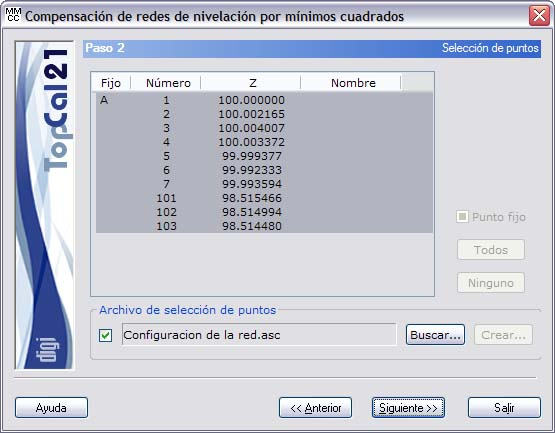

# Paso 2: Selección de puntos
<!-- id: topcal21-compensacion-mmcc-de-red-de-nivelacion-paso-2-seleccion-de-puntos -->

Este es el segundo paso del cálculo. Se muestra una pantalla con los puntos que intervienen en la nivelación almacenada en el fichero seleccionado en el *Paso 1*.

El listado que se muestra contiene los siguientes campos:

* **Casilla de fijo**: Esta casilla indica si el punto es fijo o no. Si es fijo aparecerá una letra *A*. Para poder asignar esta característica a los puntos, seleccione los puntos deseados y active o desactive la casilla **Punto fijo en altimetría** situada en la parte derecha del listado.
* **Número de punto**
* **Cota del punto**
* **Nombre del punto**

Se podrán seleccionar múltiples puntos utilizando la tecla *CTRL* y pulsando con el botón izquierdo del ratón sobre los puntos deseados. Si se pulsa sobre un punto ya seleccionado, éste se deselecciona.

También se pueden seleccionar puntos dispuestos en rangos, pulsando la tecla *MAYÚSCULAS* y el botón izquierdo del ratón sobre los puntos límite que definen el rango.

De la misma forma, se pueden utilizar los botones de **Todos** o **Ninguno** para seleccionar o deseleccionar todos los puntos.

También es posible cargar la información de la red a partir de un fichero ASCII de configuración de la red activando la casilla situada a la izquierda del nombre del archivo y pulsando el botón **Buscar** para desplegar el Explorador de Windows.

Además, si es la primera vez que se configura la red, se pueden seleccionar los puntos manualmente y crear el archivo de configuración para ser utilizado en posteriores ocasiones pulsando el botón **Crear**. El programa mostrará el Explorador de Windows para guardar el archivo; se recomienda guardarlo en la carpeta del proyecto, junto con los demás archivos del proyecto.

Para realizar la compensación, únicamente es necesario que haya un punto fijo, pudiendo haber más.

Cuando se hayan seleccionado los puntos deseados se puede pulsar al botón **Siguiente** para acceder al [Paso 3: Selección de visuales](paso-3-seleccion-de-visuales.md) o volver al [Paso 1: Selección de archivos de entrada y salida](paso-1-seleccion-de-archivos-de-entrada-y-salida.md) pulsando el botón **Anterior**.
