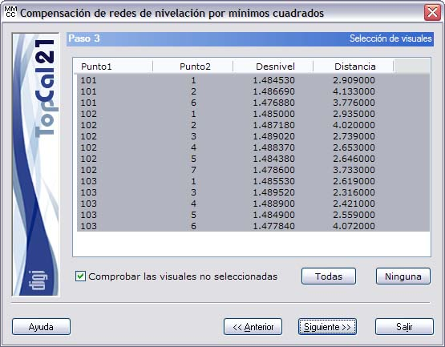

# Paso 3: Selección de visuales
<!-- id: topcal21-compensacion-mmcc-de-red-de-nivelacion-paso-3-seleccion-de-visuales -->

El tercer paso en el ajuste de la red es la selección de las visuales que formarán el cálculo.

El programa muestra un listado con las visuales del fichero seleccionado en el *Paso 1* con sus respectivas lecturas.

Esta manera de presentar los datos permitirá al usuario deseleccionar la visual que no desee que entre en el cálculo en función de los resultados posteriores.

Además, se muestra la casilla **Comprobar a posteriori las visuales no seleccionadas**. Al activarla, el programa calcula el error de las observaciones que no se han seleccionado en este listado utilizando las coordenadas ajustadas, y escribe el listado con esos errores en el archivo de salida, a continuación del test de fiabilidad.

Cuando haya seleccionado las visuales que utilizará en el ajuste, puede pulsar el botón **Siguiente** para acceder al [Paso 4: Pesos y residuos de los desniveles](paso-4-pesos-y-residuos-de-los-desniveles.md) o volver al [Paso 2: Selección de puntos](paso-2-seleccion-de-puntos.md) pulsando el botón **Anterior**.
