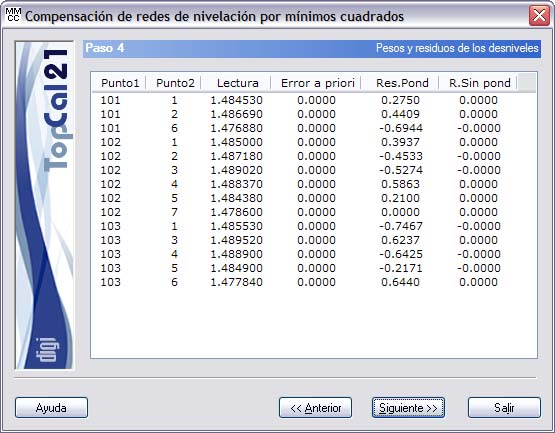

# Paso 4: Pesos y residuos de los desniveles
<!-- id: topcal21-compensacion-mmcc-de-red-de-nivelacion-paso-4-pesos-y-residuos-de-los-desniveles -->

En el siguiente paso del ajuste, el programa analiza a priori los desniveles que van a entrar en el cálculo, mostrando un listado con los siguientes datos:

* **Punto 1**
* **Punto 2**
* **Lectura**: Desniveles calculados en metros.
* **Error a priori**: Este error es el error accidental que tiene este desnivel y depende de la distancia de observación y del tipo de instrumental. Viene expresado en metros.
* **Residuo ponderado**: Este valor adimensional es el resultado de dividir el residuo sin ponderar por el error a priori que tiene la visual.
* **Residuo sin ponderar**: Este valor es la diferencia entre el desnivel observado (la propia visual) y el desnivel calculado con las coordenadas aproximadas de los puntos. La diferencia puede deberse a errores de observación o de las coordenadas aproximadas. Viene expresado en metros.

Pulsando sobre la cabecera de este listado es posible ordenar de forma ascendente o descendente según la columna pulsada.

Se puede pulsar el botón **Siguiente** para acceder al [Paso 5: Desplazamientos y precisiones](paso-5-desplazamientos-y-precisiones.md) o volver al [Paso 3: Selección de visuales](paso-3-seleccion-de-visuales.md) pulsando el botón **Anterior**.
