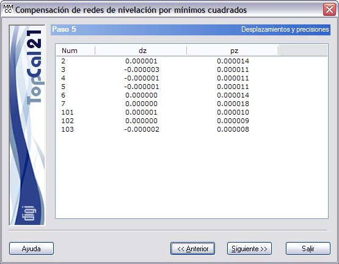

# Paso 5: Desplazamientos y precisiones altimétricas
<!-- id: topcal21-compensacion-mmcc-de-red-de-nivelacion-paso-5-desplazamientos-y-precisiones-altimetricas -->

En este paso, el programa ajusta la red altimétrica y muestra el resultado presentando los desplazamientos que sufren las coordenadas de los puntos no fijos y sus precisiones.

Los desplazamientos dependen de la diferencia entre las cotas aproximadas y las cotas obtenidas en el ajuste. Sin embargo, el valor de estas cotas aproximadas no influirá en el valor de las precisiones alcanzadas. Como se ha comentado al principio, no es necesario haber calculado unas coordenadas aproximadas.

Estos resultados se muestran en un listado, donde cada línea corresponde a un punto no fijo y cuyos campos son los siguientes:

* **Número del punto**
* **Desplazamiento en Z**: Este es el desplazamiento que sufre la coordenada Z aproximada del punto después del ajuste en metros. Si no se dispone de cotas aproximadas, este valor coincidirá con el valor de la altitud del punto.
* **Precisión en Z**: Esta es la precisión alcanzada para la coordenada Z en metros.

Si por falta de redundancia no se ha podido calcular la precisión de un punto, aparecerá el carácter “?” en este campo. Pulsando sobre la cabecera de este listado es posible ordenar de forma ascendente o descendente según la columna pulsada.

Este paso sólo es de información, no es necesario seleccionar nada. Por ello, se puede pulsar al botón **Siguiente** para acceder al [Paso 6: Resultados del test de Baarda](paso-6-resultados-del-test-de-baarda.md) o volver al [Paso 4: Pesos y residuos de los desniveles](paso-4-pesos-y-residuos-de-los-desniveles.md) pulsando el botón **Anterior**.
