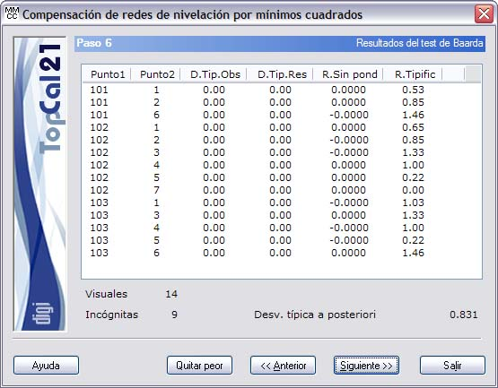

# Paso 6: Resultados del test de Baarda
<!-- id: topcal21-compensacion-mmcc-de-red-de-nivelacion-paso-6-resultados-del-test-de-baarda -->

Una vez realizado el ajuste y presentados los resultados, el siguiente paso está dedicado al test estadístico de Baarda. El programa muestra los residuos tipificados de las observaciones que han intervenido en el cálculo y la desviación típica del ajuste.

Este test detecta posibles errores groseros en visuales por medio de un valor adimensional denominado residuo tipificado. Si este valor supera un umbral que está en el valor 3.29, se puede decir que la visual es errónea con un 99.9% de probabilidad.

En el proceso de eliminación de visuales erróneas se debe proceder de una en una y siempre empezando por la visual con el mayor residuo tipificado, debido a que una visual puede afectar a las demás visuales. Puede deseleccionar esa visual manualmente, volviendo al *Paso 3*, o con el botón **Quitar peor**, que la deselecciona en ese paso.

El resultado del test estadístico se refleja en un listado que tiene los siguientes campos:

* **Punto1**
* **Punto2**
* **Desviación típica de la observación**, cuya unidad es la misma que la de la observación
* **Desviación típica del residuo**, cuya unidad es la misma que la de la observación
* **Residuo sin ponderar**, calculado con las nuevas coordenadas calculadas y cuya unidad es la misma que la de la observación.
* **Residuo tipificado**, cuyo valor deberá ser inferior al umbral 3.29. Si es superior aparecerá la marca # a la derecha. Si no se pudo comprobar la bondad de la observación, aparecerá el carácter “?”.

Pulsando sobre la cabecera de este listado es posible ordenar de forma ascendente o descendente según la columna pulsada.

Además, se muestra el **número de visuales** utilizadas y el **número de incógnitas** que el programa ha resuelto.

Por último, también se muestra la **desviación típica a posteriori** del sistema, cuyo valor es adimensional y la interpretación es la siguiente:

* Si es inferior a 1, es que se ha llegado a una precisión mayor a la esperada para el instrumental utilizado.
* Si es 1, es que se ha llegado a una precisión igual a la esperada para este instrumental.
* Si es superior a 1, es que se ha conseguido una precisión inferior a la esperada para el citado instrumental.

Este paso sólo es de información, no es necesario seleccionar nada. Por ello, se puede pulsar al botón **Siguiente** para acceder al [Paso 7: Configurar salida de datos](paso-7-configurar-salida-de-datos.md) o volver al [Paso 5: Desplazamientos y precisiones](paso-5-desplazamientos-y-precisiones.md) pulsando el botón **Anterior**.
