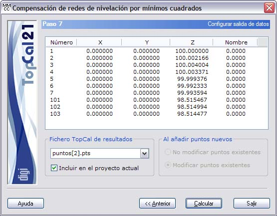

# Paso 7: Configurar salida de datos
<!-- id: topcal21-compensacion-mmcc-de-red-de-nivelacion-paso-7-configurar-salida-de-datos -->

En este paso se muestra una pantalla con las coordenadas finales calculadas y la forma de salvar dichas coordenadas. Se muestran los siguientes campos:

* **Coordenadas finales**: Se muestra un listado con los puntos nuevos calculados, sus coordenadas y su desorientación.
* **Fichero TopCal de resultados**: Se podrá seleccionar el nombre del fichero TopCal donde se almacenarán los puntos. Se podrá elegir alguno de los archivos existentes o generar un archivo nuevo. Si se desea generar un archivo nuevo, se podrá elegir añadir o no el fichero al proyecto actual.
* **Modo de añadir puntos**: Si el fichero de puntos no es nuevo se podrá elegir modificar o no los puntos con el mismo número que se encuentren en el fichero de salida elegido.

Una vez que se hayan configurado los datos de salida, se podrá terminar el proceso pulsando el botón **Calcular** o volver al [Paso 6: Resultados del test de Baarda](paso-6-resultados-del-test-de-baarda.md) pulsando el botón **Anterior**.
