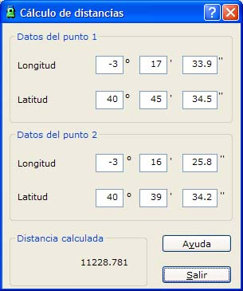

# Cálculo de distancias geográficas
<!-- id: calculo-de-distancias-geograficas -->

Con esta herramienta se puede calcular la distancia definida por las coordenadas geográficas de dos puntos. Se muestra un cuadro de diálogo que habrá que rellenar con las coordenadas geográficas (grados, minutos y segundos sexagesimales) de ambos puntos, mostrando el programa simultáneamente el resultado, en metros.

