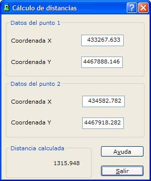

# Cálculo de distancias en proyección UTM
<!-- id: calculo-de-distancias-en-proyeccion-utm -->

Con esta herramienta se puede calcular la distancia definida por dos puntos en proyección UTM. Se muestra un cuadro de diálogo que habrá que rellenar con las coordenadas UTM en metros de ambos puntos, mostrando el programa simultáneamente el resultado, también en metros.

