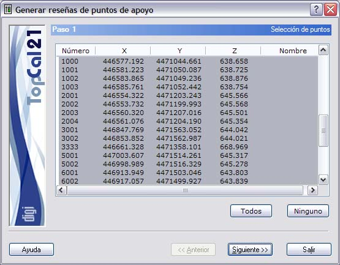

# Paso 1: Selección de puntos
<!-- id: topcal21-generar-resenas-de-puntos-de-apoyo-paso-1-seleccion-de-puntos -->

Este es el primer paso para generar reseñas de puntos de apoyo.

Se muestra una pantalla con los puntos con coordenadas almacenados en el fichero actual. Se deberán seleccionar los puntos de los que se desea generar las reseñas.

El listado que se muestra contiene los siguientes campos:

* **Número de punto**
* **Coordenadas del punto**
* **Nombre del punto**

Se podrán seleccionar múltiples puntos utilizando la tecla *\[CTRL\]* y pulsando con el botón izquierdo del ratón sobre los puntos deseados. Si se pulsa sobre un punto ya seleccionado, éste se deselecciona.

También se pueden seleccionar puntos dispuestos en rangos, pulsando la tecla *\[MAYÚSCULAS\]* y el botón izquierdo del ratón sobre los puntos límite que definen el rango.

De la misma forma, se pueden utilizar los botones de **Todos** o **Ninguno** para seleccionar o deseleccionar todos los puntos.

Una vez seleccionados los puntos deseados se podrá pulsar el botón **Siguiente** para acceder al [Paso 2: Introducción de reseñas](paso-2-introduccion-de-resenas.md).
