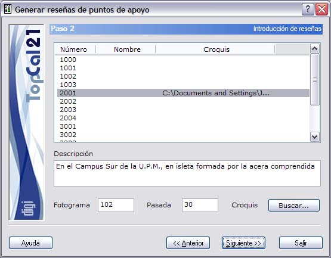

# Paso 2: Introducción de reseñas
<!-- id: topcal21-generar-resenas-de-puntos-de-apoyo-paso-2-introduccion-de-resenas -->

Este es el segundo paso para generar reseñas de puntos de apoyo.

El programa muestra una lista con los puntos seleccionados en el paso anterior, donde hay que introducir los datos adicionales, si no se introdujeron en otra ocasión, para rellenar la ficha del punto de apoyo. Asimismo, habrá que elegir el fichero que contiene el croquis del punto.

Entre estos campos, se encuentran los siguientes:

* **Descripción**: Información acerca de las características del punto de apoyo.
* **Fotograma**: Fotograma cuya zona central contiene el punto de apoyo.
* **Pasada**: Pasada en la que se encuentra el punto.

Cuando se haya rellenado toda la información de los puntos se puede pulsar el botón **Siguiente** para acceder al [Paso 3: Introducir ficheros de salida](paso-3-introducir-ficheros-de-salida.md) o volver al [Paso 1: Selección de puntos](paso-1-seleccion-de-puntos.md) pulsando el botón **Anterior**.
