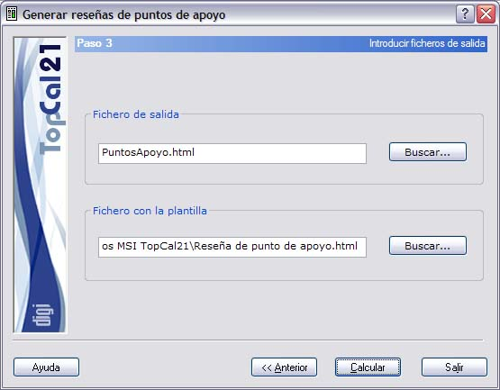

# Paso 3: Introducir ficheros de salida
<!-- id: topcal21-generar-resenas-de-puntos-de-apoyo-paso-3-introducir-ficheros-de-salida -->

Este es el tercer y último paso para generar reseñas de puntos de apoyo.

Se muestran los siguientes campos:

* **Fichero de salida**: Se deberá indicar un nombre para el archivo html de salida o ubicarlo por medio del explorador de Windows que aparece al pulsar el botón **Buscar**. Este archivo se podrá visualizar (con el visor que se hubiese indicado en el cuadro de [Preferencias](../../opciones-de-visualizacion/preferencias.md) del menú [Editar](../../menus-de-la-aplicacion/menu-editar.md)) si se activa la casilla inferior denominada **Visualizar después del cálculo**.
* **Fichero con la plantilla**: Se indicará el nombre de la plantilla html utilizada para generar las reseñas. Esta plantilla podrá haber sido creada por el usuario, o puede utilizar la plantilla incluida con el programa.

Una vez que se hayan configurado los datos de salida, se podrá terminar el proceso pulsando el botón **Calcular** o volver al paso anterior [Paso 2: Introducción de reseñas](paso-2-introduccion-de-resenas.md) pulsando el botón **Anterior**.

Al finalizar la generación de las reseñas, el programa guarda en el fichero de puntos los datos introducidos para cada punto de apoyo, de modo que el usuario puede volver a generar las reseñas sin volver a introducir los datos.
