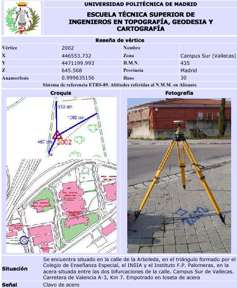

# Generar reseñas de vértices
<!-- id: generar-resenas-de-vertices -->

Esta herramienta permite generar reseñas de vértices a partir de un conjunto de puntos almacenado en un fichero TopCal. El programa genera un archivo en formato html a partir de una plantilla prediseñada por el usuario. Existe, no obstante, una plantilla por defecto incluida con el programa.

Los datos de las reseñas de vértices que el usuario introduzca quedarán almacenados en el fichero de puntos, de tal manera que podrán ser utilizados en más ocasiones.

El cálculo se compone de tres pasos, que son los siguientes:

* [Paso 1: Selección de puntos](paso-1-seleccion-de-puntos.md)
* [Paso 2: Introducción de reseñas](paso-2-introduccion-de-resenas.md)
* [Paso 3: Introducir ficheros de salida](paso-3-introducir-ficheros-de-salida.md)

Use los botones **Siguiente** y **Anterior** para cambiar de paso y modificar los datos o las selecciones.
