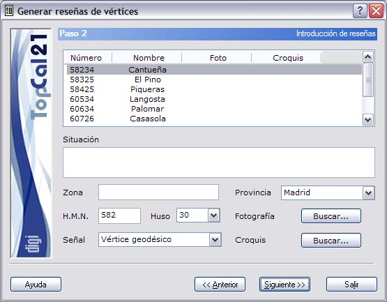

# Paso 2: Introducción de reseñas
<!-- id: topcal21-generar-resenas-de-vertices-paso-2-introduccion-de-resenas -->

Este es el segundo paso para generar reseñas de vértices.

El programa muestra una lista con los puntos seleccionados en el paso anterior, donde hay que introducir los datos adicionales, si no se introdujeron en otra ocasión, para rellenar la ficha del vértice. Asimismo, habrá que elegir los ficheros que contienen la fotografía y el croquis del punto.

Entre estos campos, se encuentran los siguientes:

* **Situación**: Descripción literal de la situación del punto.
* **Zona**: Lugar dentro de la provincia donde se encuentra el punto.
* **Provincia**: Se deberá seleccionar una provincia.
* **H.M.N.**: Hoja del Mapa Nacional donde se encuentra el punto.
* **Huso**.
* **Señal**: Tipo de señal utilizada para señalar el punto.

Cuando se haya rellenado toda la información de los puntos se puede pulsar el botón **Siguiente** para acceder al [Paso 3: Introducir ficheros de salida](paso-3-introducir-ficheros-de-salida.md) o volver al [Paso 1: Selección de puntos](paso-1-seleccion-de-puntos.md) pulsando el botón **Anterior**.
