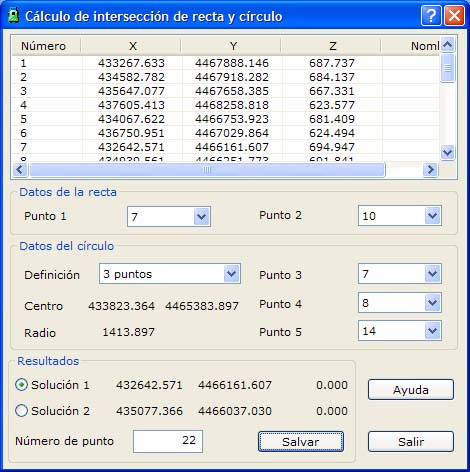

# Intersección de recta y círculo
<!-- id: interseccion-de-recta-y-circulo -->

Con esta herramienta se puede calcular la intersección entre una recta y un círculo. La definición de la recta puede ser por dos puntos o por un punto y un acimut. La definición de dichos círculos puede ser alguna de las siguientes:

* **Tres puntos**: Círculo que pasa por tres puntos
* **Dos puntos**: Círculo que tiene un diámetro definido por dos puntos
* **Centro y radio**
* **Centro y un punto del círculo**: Círculo con centro en un punto y que pasa por otro punto

Según se seleccione un tipo u otro de definición de puntos se activarán o desactivarán campos referentes a dichas definiciones. Los campos que se presentan son los siguientes:

* **Listado de puntos**: Lista de puntos del fichero actual
* **Datos de la recta**. Según la opción seleccionada puede mostrar
  * *Punto 1, Punto 2*
  * *Punto 1, Acimut*
* **Datos del círculo**
  * *Definición*: Tipo de definición. Las posibilidades y campos a rellenar son los siguientes:
    * *3 puntos*: Punto 3, Punto 4, Punto 5
    * *2 puntos*: Punto 3, Punto 4
    * *Centro y Radio*: Centro, Radio en metros
    * *Centro y Punto*: Centro, Punto de círculo
  * *Centro*: Centro calculado
  * *Radio*: Radio calculado en metros
* **Resultados**
  * *Solución 1*
  * *Solución 2*
  * *Número de punto*

Una vez que se haya calculado la intersección, pulsando el botón **Salvar**, se podrá salvar en el fichero de puntos la solución seleccionada, con el número de punto señalado en el campo **Número de punto**.

