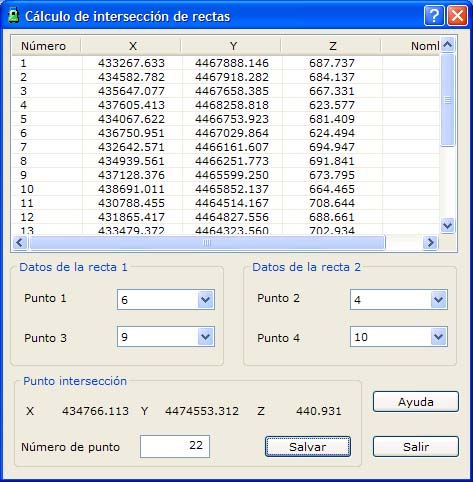

# Intersección de rectas
<!-- id: interseccion-de-rectas -->

Con esta herramienta se puede calcular la intersección entre rectas. La definición de las recta puede ser por dos puntos o por un punto y un acimut.

Según se seleccione un tipo u otro de definición de la recta se activarán o desactivarán campos referentes a dichas definiciones. Los campos que se presentan son los siguientes:

* **Listado de puntos**: Lista de puntos del fichero actual
* **Datos de la recta 1**. Según la opción seleccionada puede mostrar
  * *Punto 1, Punto 3*
  * *Punto 1, Acimut 1*
* **Datos de la recta 2**. Según la opción seleccionada puede mostrar
  * *Punto 2, Punto 4*
  * *Punto 2, Acimut 2*
* **Punto intersección**
  * *Coordenadas X, Y, Z*
  * *Número de punto*

Una vez calculada la intersección, pulse el botón **Salvar** para guardar el punto de intersección en el fichero de puntos con el número indicado en el campo **Número de punto**.

