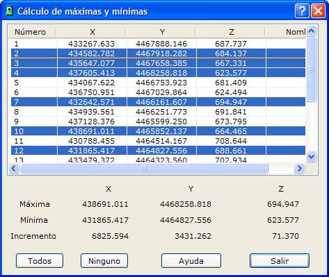

# Máximas y mínimas
<!-- id: maximas-y-minimas -->

Con esta herramienta se puede calcular las coordenadas máximas y mínimas de un conjunto de puntos dado. Los campos que se presentan son los siguientes:

* **Listado de puntos**: Lista de puntos del fichero actual
* **Máximas X, Y, Z**: Coordenadas máximas de los puntos seleccionados
* **Mínimas X, Y, Z**: Coordenadas mínimas de los puntos seleccionados
* **Incrementos X, Y, Z**: Diferencias entre las máximas y mínimas de los puntos seleccionados

Se podrán seleccionar múltiples puntos utilizando la tecla *\[CTRL\]* y pulsando con el botón izquierdo del ratón sobre los puntos deseados. Si se pulsa sobre un punto ya seleccionado, éste se deselecciona.

También se pueden seleccionar puntos dispuestos en rangos, pulsando la tecla *\[MAYÚSCULAS\]* y el botón izquierdo del ratón sobre los puntos límite que definen el rango.

De la misma forma, se pueden utilizar los botones de **Todos** o **Ninguno** para seleccionar o deseleccionar todos los puntos.

