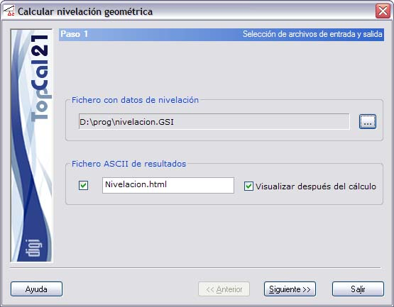

# Paso 1: Selección de archivos de entrada y salida
<!-- id: topcal21-nivelacion-geometrica-paso-1-seleccion-de-archivos-de-entrada-y-salida -->

Este es el primer paso para calcular la nivelación geométrica.

Se muestra una pantalla donde se deben introducir los ficheros de entrada con los datos y de la salida con el cálculo de la nivelación:

* **Fichero con datos de nivelación**: Se podrá seleccionar el fichero de entrada pulsando el botón que aparece a la derecha del nombre del fichero. El formato de este fichero debe ser GSI generado por los equialtímetros de Leica.
* **Fichero ASCII de resultados**: Este archivo podrá ser del formato html o de formato ASCII. Si la extensión de este archivo es HTM o html se tomará como formato html y en caso contrario se tomará como formato ASCII. Este archivo se podrá visualizar (con el visor que se hubiese indicado en el cuadro de [Preferencias](../../opciones-de-visualizacion/preferencias.md) del [menú Editar](../../menus-de-la-aplicacion/menu-editar.md)) si se activa la casilla situada a la derecha denominada **Visualizar después del cálculo**. El archivo de resultados se creará en el directorio del fichero con los datos de nivelación.

Una vez introducidos estos datos se podrá pulsar el botón **Siguiente** para acceder al Paso 2: Desniveles calculados.
