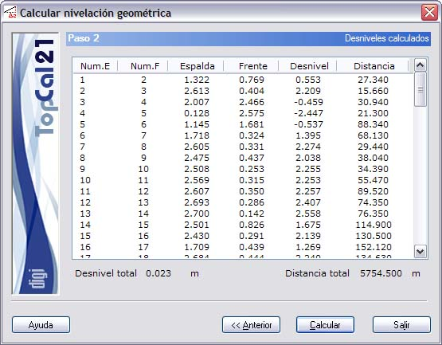

# Paso 2: Desniveles calculados
<!-- id: topcal21-nivelacion-geometrica-paso-2-desniveles-calculados -->

Este es el segundo y último paso para el cálculo de la nivelación geométrica.

Se muestra un listado con los cálculos repartidos en las siguientes columnas:

* **Num.E**: Número del punto visado con la visual de Espaldas.
* **Num.F**: Número del punto visado con la visual de Frente.
* **Espalda**: Lectura realizada de Espaldas en metros.
* **Frente**: Lectura realizada de Frente en metros.
* **Desnivel**: Desnivel en metros calculado a partir de las visuales.
* **Distancia**: Distancia en metros entre las miras.

En la parte inferior se muestra el desnivel total calculado, así como la distancia entre los puntos inicial y final.

Una vez que se hayan analizado los datos calculados, se podrá terminar el proceso pulsando el botón **Calcular** o volver al paso anterior [Paso 1: Selección de archivos de entrada y salida](paso-1-seleccion-de-archivos-de-entrada-y-salida.md) pulsando el botón **Anterior**.
