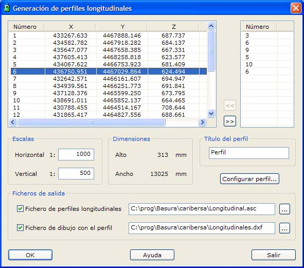

# Perfiles longitudinales
<!-- id: perfiles-longitudinales -->

Con esta herramienta se pueden calcular perfiles longitudinales formados por un conjunto de puntos almacenados en un fichero de puntos de TopCal.

El programa muestra un cuadro de diálogo con los puntos disponibles mostrando sus coordenadas y su número de punto. A la derecha de esta lista, se muestran los puntos que van a formar parte del perfil y que se pueden ir añadiendo pulsando doble clic sobre el punto en cuestión o pulsando el botón con la señal **>>**. Asimismo, es posible eliminarlos del perfil con el botón con la señal **&lt;&lt;**.

Es posible indicar las escalas horizontal y vertical para la generación del correspondiente archivo de dibujo, expresándose a continuación el tamaño en milímetros de ploteo que tendrá el citado perfil, en función de su longitud, las escalas y las opciones de la guitarra del perfil (la parte inferior de la caja del perfil, que muestra cotas, distancias y números de punto).

Además, el programa puede generar dos tipos de archivos de salida:

* Un fichero de texto con el listado de los puntos que forman el perfil.
* Un fichero de dibujo con el perfil longitudinal y una guitarra con la información relativa a éste. Esta guitarra se puede personalizar a través de su propio [cuadro de diálogo](configuracion-de-la-guitarra.md). El formato del archivo dependerá de la extensión que lleve:
  * Extensión BIN para archivos DIGI.
  * Extensión DXF para archivos AutoCad.
  * Extensión DGN para archivos MicroStation: En este caso, al pulsar el botón **Aceptar**, el programa mostrará un [cuadro de diálogo](../../otros-comandos/parametros-para-exportar-a-dgn.md) donde pedirá que se indique el nombre del archivo que actuará de semilla y, si se tiene, una tabla de traducción de los códigos TopCal al sistema de codificación de MicroStation (nivel, estilo, color, peso y grupo gráfico).
