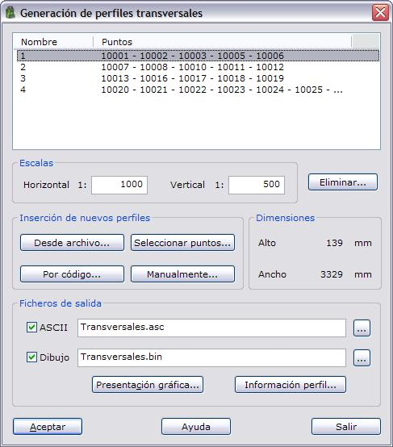

# Perfiles transversales
<!-- id: topcal21-perfiles-transversales -->

TopCal 21 permite la construcción de perfiles transversales con esta herramienta, permitiendo varias posibilidades para la introducción de los datos:

* [Desde un archivo ASCII](insercion-de-nuevos-perfiles-desde-archivo.md): A partir de un fichero ASCII con puntos donde se indica la cota y la distancia al eje.
* [Seleccionando puntos del archivo actual](insercion-de-nuevos-perfiles-seleccionando-puntos.md): El usuario elige de forma interactiva los puntos que forman el perfil.
* [Seleccionando puntos del archivo actual según su código](insercion-de-nuevos-perfiles-por-codigo.md): El programa selecciona los perfiles formados por puntos cuyo código coincide.
* [Manualmente](insercion-de-nuevos-perfiles-manualmente.md): Indicando el valor de la distancia el eje y la cota para cada punto que forma el perfil.

De esta manera, se pueden añadir todos los perfiles que se desean de cualquiera de estas formas, mostrándose en el listado de la parte superior del cuadro de diálogo. De este listado también es posible eliminar un perfil, pulsando el botón **Eliminar**.

Por otro lado, es posible indicar las escalas **horizontal** y **vertical** para la generación del correspondiente archivo de dibujo. El programa calcula automáticamente las dimensiones que tendría el archivo de dibujo en coordenadas de ploteo para saber si se pueden encajar los perfiles seleccionados en la hoja de ploteo. Los valores de las escalas y las dimensiones de ploteo sólo tendrán utilidad si se desea obtener un archivo de dibujo.

Como archivos de salida, el programa puede generar dos tipos diferentes:

* Un **fichero de texto** con el listado de los puntos que forman el perfil. Este archivo contendrá un listado donde aparece el nombre de cada perfil y, a continuación, los puntos que conforman el perfil, mostrándose por columnas su número, distancia al eje, cota y distancia acumulada del perfil.
* Un **fichero de dibujo** con todos los perfiles transversales. Si se selecciona este tipo de archivo se activarán los botones para poder configurar su salida:
  * [Presentación gráfica](presentacion-grafica-de-los-perfiles-transversales.md): Para configurar la organización de los perfiles dentro del archivo de dibujo.
  * [Información del perfil](configuracion-de-la-guitarra.md): Para seleccionar los campos que aparecerán en la guitarra y configurar los textos: su posición, su código de dibujo y su altura.

  El formato del archivo dependerá de la extensión que lleve:
  * Extensión BIN para archivos DIGI.
  * Extensión DXF para archivos AutoCad.
  * Extensión DGN para archivos MicroStation: En este caso, al pulsar el botón **Aceptar**, el programa mostrará un [cuadro de diálogo](../../otros-comandos/parametros-para-exportar-a-dgn.md) donde pedirá que se indique el nombre del archivo que actuará de semilla y, si se tiene, una tabla de traducción de los códigos TopCal al sistema de codificación de MicroStation (nivel, estilo, color, peso y grupo gráfico).

Se puede seleccionar la ubicación de ambos archivos pulsando el correspondiente botón que aparece a la derecha del nombre del archivo. Si no se indica ninguna carpeta, los archivos de salida se generarán en la carpeta del proyecto, si el fichero de puntos pertenece a uno, o en la carpeta del fichero de puntos en caso contrario.
