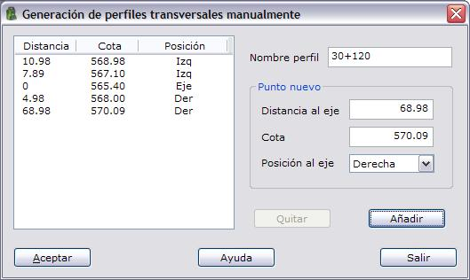

# Inserción de nuevos perfiles manualmente
<!-- id: insercion-de-nuevos-perfiles-manualmente -->

Es posible insertar perfiles indicando de forma manual las características de los puntos que configuran cada perfil.

El programa muestra un cuadro de diálogo donde se pueden ir añadiendo los puntos indicando los siguientes campos:

* **Distancia al eje**: Se indicará el valor de la distancia al eje. No es necesario introducir signo en este campo, se asignará automáticamente en función de la posición del punto. Si el valor es cero, se interpretará como punto del eje. No es posible añadir dos puntos con distancia igual a cero.
* **Cota**
* **Posición al eje**: Se indicará la posición del punto respecto del eje, izquierda o derecha. Los puntos que se sitúen a la izquierda se les asignará una distancia al eje negativa.

Los puntos se pueden introducir sin ordenarlos por distancia al eje, ya que el programa los ordenará en función de su distancia al eje.

Para añadir un punto se deberá pulsar el botón **Añadir**. Para eliminar un punto se deberá elegir del listado y a continuación pulsar el botón **Quitar**.

Antes de aceptar los datos, se deberá designar un nombre para le perfil en el campo **Nombre del perfil**.

