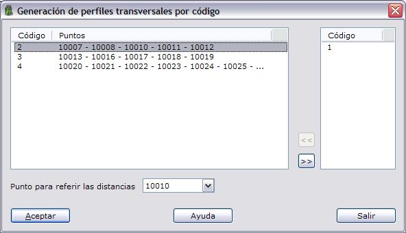

# Inserción de nuevos perfiles por código
<!-- id: insercion-de-nuevos-perfiles-por-codigo -->

Es posible insertar perfiles a partir de los puntos almacenadas en el fichero de puntos actual utilizando el código para relacionarlos automáticamente.

El programa muestra un listado con los perfiles que ha podido relacionar a partir de los puntos del fichero actual. Para ello, los puntos que conforme un perfil deben estar consecutivos en el fichero y tener el mismo código.

El usuario podrá seleccionar los perfiles que desee y podrá designar qué punto de los que conforman el perfil actuará como origen para medir las distancias. Esta información puede darse en el campo que aparece en la parte inferior del listado de perfiles.

Para incluir un perfil se deberá seleccionar de la lista y pulsar el botón con la señal **>>** o hacer doble clic con el botón izquierdo del ratón. También es posible eliminar un perfil de la lista de seleccionados pulsando el botón con la señal **&lt;&lt;** o haciendo doble clic con el botón izquierdo sobre esta lista.

Se tomará como nombre del perfil el valor del campo código.

