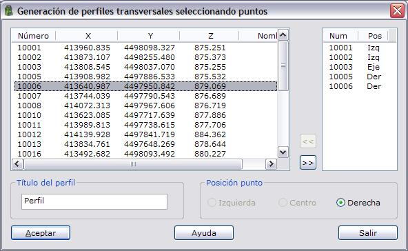

# Inserción de nuevos perfiles seleccionando puntos
<!-- id: insercion-de-nuevos-perfiles-seleccionando-puntos -->

Es posible insertar nuevos perfiles transversales seleccionando los puntos que conforman el perfil del fichero de puntos actual.

El programa muestra un cuadro de diálogo donde aparece el listado con todos los puntos que se pueden incluir en el perfil.

Para incluir un nuevo punto en el perfil se deberá seleccionar de la lista y pulsar el botón con la señal **>>** o hacer doble clic con el botón izquierdo del ratón. Pero antes de incluir se deberá indicar si el punto está a la izquierda, a la derecha o si es el eje del perfil transversal. Para ello se deberá elegir la opción en el campo **Posición punto**.

El programa permitirá ir introduciendo puntos a la izquierda del eje hasta que se designe un punto que actúe como eje. A partir de entonces, los puntos sólo podrán incluirse a la derecha del eje.

También es posible eliminar un punto de la lista de seleccionados pulsando el botón con la señal **&lt;&lt;** o haciendo doble clic con el botón izquierdo sobre esta lista.

El programa permite repetir puntos en la configuración del perfil.

Antes de aceptar los datos, se deberá designar un nombre para le perfil en el campo **Título del perfil**.

