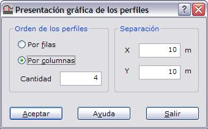

# Presentación gráfica de los perfiles transversales
<!-- id: presentacion-grafica-de-los-perfiles-transversales -->

Desde esta herramienta se puede configurar la presentación de los perfiles dentro del archivo dibujo, pudiéndose ordenar en función de filas o columnas y pudiendo indicar el número máximo de perfiles en cada serie. En el cuadro de diálogo que se muestra, aparecen los siguientes campos a rellenar:

* **Orden de los perfiles**: Si se alinean por columnas o por filas.
* **Cantidad por fila o columna**: Cantidad de perfiles en cada fila o columna.
* **Separación en X / Y**: Separación en metros entre perfiles en cada eje.

