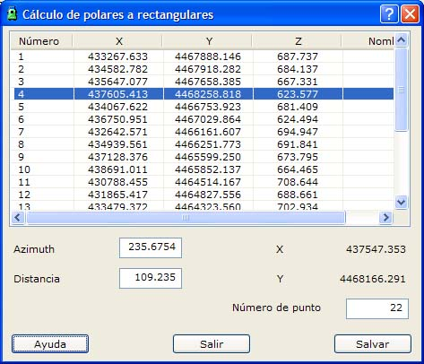

# Polares a rectangulares
<!-- id: polares-a-rectangulares -->

Con esta herramienta se puede calcular las coordenadas de un punto a partir del acimut y distancia medida desde otro punto de coordenadas conocidas. El cuadro de diálogo muestra los siguientes campos:

* **Listado de puntos**: Listado de puntos del fichero actual. Se deberá seleccionar un punto a partir del cual se calcularán las coordenadas del nuevo punto
* **Acimut**: En grados centesimales.
* **Distancia**: En metros.
* **Coordenadas X, Y del punto calculado**
* **Número de punto**

Una vez calculado el punto, pulse el botón **Salvar** para guardar el punto calculado en el fichero de puntos con el número indicado en el campo **Número de punto**.

