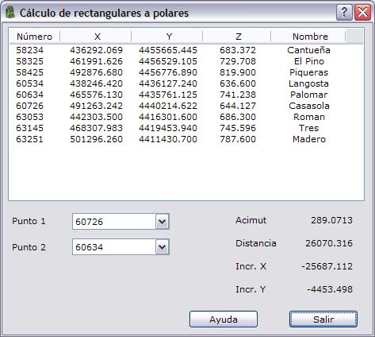

# Rectangulares a polares
<!-- id: rectangulares-a-polares -->

Con esta herramienta se puede calcular el acimut y distancia entre dos puntos. El cuadro de diálogo muestra los siguientes campos:

* **Listado de puntos**: Listado de puntos del fichero actual. Seleccione en **Punto 1** y **Punto 2** los dos puntos entre los que desea calcular el acimut y la distancia.
* **Punto 1:** Primer punto para calcular el acimut y la distancia
* **Punto 2**: Segundo punto para calcular el acimut y la distancia
* **Acimut**: En grados centesimales.
* **Distancia**: En metros.
* **Incremento en X**: En metros.
* **Incremento en Y**: En metros.

Esta herramienta no salva ningún resultado en el archivo, solamente muestra datos calculados.

