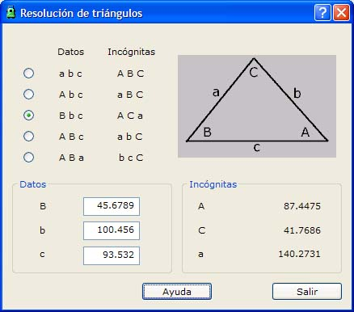

# Resolución de triángulos
<!-- id: resolucion-de-triangulos -->

Con esta herramienta se pueden calcular los elementos de un triángulo conociendo ciertos datos de dicho triángulo. Los datos correspondientes a los lados se muestran con letras minúsculas y los datos correspondientes a los ángulos se muestran con letras mayúsculas, como muestra la figura. El cuadro de diálogo muestra los siguientes campos:

* **Selección de los datos y las incógnitas**. Las opciones son las siguientes:
  * Si se conocen los tres lados (a, b, c)
  * Si se conoce un ángulo y los lados que lo forman (A, b, c)
  * Si se conoce un ángulo, un lado que lo forma y el lado opuesto (B, b, c)
  * Si se conocen dos ángulos y el lado común que los forman (A, B, c)
  * Si se conocen dos ángulos y un lado no común (A, B, a)
* **Valor de los datos**: Si son ángulos, los valores se darán en grados centesimales. Si son lados, se darán en metros.
* **Valor de las incógnitas**: Si son ángulos, los valores se darán en grados centesimales. Si son lados, se darán en metros.

Esta herramienta no salva ningún resultado en el archivo, solamente muestra datos calculados.

