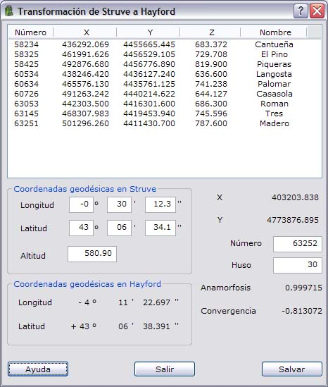

# Transformación de coordenadas del elipsoide de Struve al de Hayford
<!-- id: transformacion-de-coordenadas-del-elipsoide-de-struve-al-de-hayford -->

La aplicación dispone de una herramienta que permitirá al usuario realizar el cambio de las coordenadas de la antigua red geodésica española cuyo elipsoide era el de Struve y cuyo datum estaba en Madrid.

Para ello, el programa muestra un cuadro de diálogo donde se podrán añadir puntos nuevos al fichero indicando únicamente las coordenadas geodésicas (**longitud** y **latitud**) en aquel sistema y el huso en el que se encuentra el punto para transformar estas coordenadas en coordenadas en el sistema ED-50 (datum en Postdam) y en proyección UTM.

Una vez calculado el punto, pulse el botón **Salvar** para guardar el punto calculado en el fichero de puntos con el número indicado en el campo **Número de punto** y la altitud indicada en el campo **Altitud**.

