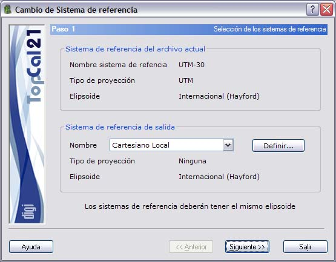

# Paso 1: Selección de los sistemas de referencia
<!-- id: topcal21-transformacion-de-coordenadas-entre-diferentes-sistemas-de-referencia-paso-1-seleccion-de-los-sistemas-de-referencia -->

En el primer paso para el Cambio de sistema de referencia, se muestran los sistemas de entrada y de salida. El sistema de referencia de entrada corresponde con el definido para el archivo actual que se va a transformar.

El sistema de referencia de salida se puede elegir de la lista disponible al efecto. Se recomienda que, para una correcta transformación, el sistema de referencia de salida elegido tenga el mismo elipsoide que el de entrada.

Si el sistema de referencia deseado no está disponible en la lista se puede pulsar el botón **Definir** para crear uno nuevo. El programa, entonces, mostrará el cuadro de diálogo [Sistemas de referencia](../../otros-comandos/sistemas-de-referencia/listado-de-sistemas-de-referencia.md).

Una vez introducidos estos datos se podrá pulsar el botón **Siguiente** para acceder al [Paso 2: Selección de puntos](paso-2-seleccion-de-puntos.md).
