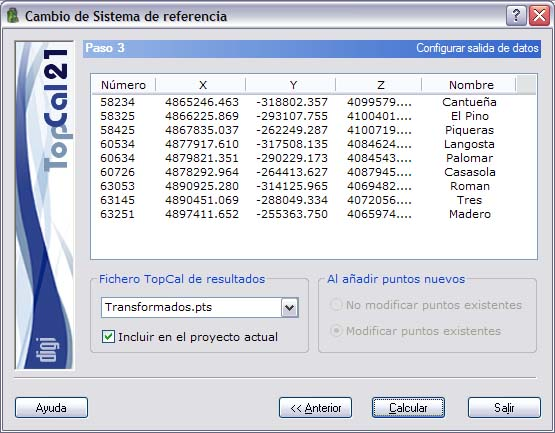

# Paso 3: Configurar salida de datos
<!-- id: topcal21-transformacion-de-coordenadas-entre-diferentes-sistemas-de-referencia-paso-3-configurar-salida-de-datos -->

Este es el tercer y último paso en el cambio de sistema de referencia donde, a parte de un listado con las coordenadas de los puntos transformados, se muestran los siguientes campos:

* **Fichero TopCal de resultados**: Se podrá seleccionar el nombre del fichero TopCal donde se almacenarán los puntos. Se podrá elegir alguno de los archivos existentes o generar un archivo nuevo. Si se desea generar un archivo nuevo, se podrá elegir añadir o no el fichero al proyecto actual.
* **Modo de añadir puntos**: Si el fichero de puntos ya existe, puede elegir **Modificar puntos existentes** o **No modificar puntos existentes** para los puntos del fichero de salida cuyo número coincide con el de los puntos calculados.

Una vez que se hayan configurado los datos de salida, se podrá terminar el proceso pulsando el botón **Calcular** o volver al paso anterior [Paso 2: Selección de puntos](paso-2-seleccion-de-puntos.md) pulsando el botón **Anterior**.
