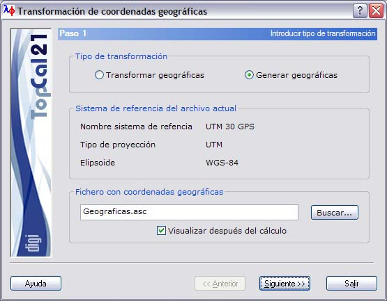

# Paso 1: Introducir tipo de transformación
<!-- id: topcal21-transformacion-de-coordenadas-geograficas-paso-1-introducir-tipo-de-transformacion -->

Este es el primer paso para calcular la transformación de coordenadas de geográficas, en el que se indica el tipo de transformación a realizar. Asimismo, se ofrecen las características del sistema de referencia del archivo actual, utilizado para la transformación de las coordenadas geográficas. Los datos requeridos son los siguientes:

* **Tipo de transformación**:
  * *Transformar geográficas*: Seleccione esta opción si desea transformar un archivo de coordenadas geográficas al archivo de puntos actual. El archivo ASCII con las coordenadas geográficas deberá tener los datos colocados en columnas, separadas por espacios, comas o tabuladores, con los siguientes campos: *Número de punto*, *Longitud* en grados sexagesimales en formato pseudodecimal, *Latitud* en grados sexagesimales en formato pseudodecimal, *Altitud* en metros y el *Nombre* del punto si lo tiene.

Para introducir ángulos en formato pseudodecimal, introduzca los grados, un punto decimal, dos dígitos para los minutos, dos dígitos para los segundos y los decimales de los segundos. Por ejemplo, el ángulo 90 grados 38 minutos 45.67 segundos se introduce como 90.384567.

* *Generar geográficas*: Seleccione esta opción si desea transformar el archivo de puntos actual a un archivo con coordenadas geográficas. Este archivo podrá ser del formato html o de formato ASCII. Si la extensión de este archivo es HTM o html se tomará como formato html y en caso contrario se tomará como formato ASCII. Este archivo se podrá visualizar (con el visor que se hubiese indicado en el cuadro de [Preferencias](../../opciones-de-visualizacion/preferencias.md) del [menú Editar](../../menus-de-la-aplicacion/menu-editar.md)) si se activa la casilla inferior denominada **Visualizar después del cálculo**. El archivo generado tendrá los siguientes campos: *Número de punto*, *Longitud* en grados sexagesimales en formato pseudodecimal, *Latitud* en grados sexagesimales en formato pseudodecimal, *Altitud* en metros, *coeficiente de anamorfosis lineal* de la proyección UTM y el *Convergencia de meridianos* en grados sexagesimales en formato pseudodecimal.
* **Fichero con coordenadas geográficas**: Se escribirá el nombre del fichero ASCII con las coordenadas geográficas. Este archivo deberá existir si se eligió como tipo de transformación *Transformar geográficas* o se creará nuevo si se eligió la opción *Generar geográficas*. La ubicación de este archivo será, por defecto, la misma que la del archivo de puntos actual. Si se desea cambiar la ubicación podrá utilizar el botón **Buscar**.

Una vez introducidos estos datos se podrá pulsar el botón **Siguiente** para acceder al [Paso 2: Selección de los puntos a transformar](paso-2-seleccion-de-los-puntos-a-transformar.md).
