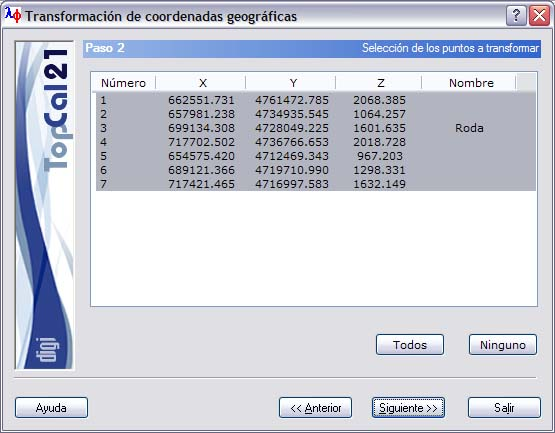
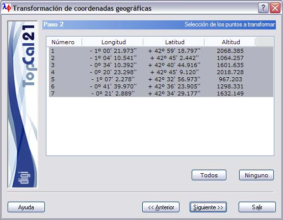

# Paso 2: Selección de puntos a transformar
<!-- id: topcal21-transformacion-de-coordenadas-geograficas-paso-2-seleccion-de-puntos-a-transformar -->

Este es el segundo paso para el cálculo de la transformación de coordenadas geográficas.

Si la transformación seleccionada en el paso anterior fue *Transformar geográficas*, se muestra una pantalla con las coordenadas geográficas de los puntos leídos del archivo indicado. Este listado contiene los siguientes campos:

* **Número de punto**
* **Longitud**, en grados sexagesimales
* **Latitud**, en grados sexagesimales
* **Altitud**

Si la transformación seleccionada en el paso anterior fue *Generar geográficas*, se muestra una pantalla con las coordenadas de los puntos del archivo actual. Este listado contiene los siguientes campos:

* **Número de punto**
* **Coordenadas del punto**
* **Nombre del punto**

En este paso se deberán seleccionar los puntos que se desean transformar.

Se podrán seleccionar múltiples puntos utilizando la tecla *\[CTRL\]* y pulsando con el botón izquierdo del ratón sobre los puntos deseados. Si se pulsa sobre un punto ya seleccionado, éste se deselecciona.

También se pueden seleccionar puntos dispuestos en rangos, pulsando la tecla *\[MAYÚSCULAS\]* y el botón izquierdo del ratón sobre los puntos límite que definen el rango.

De la misma forma, se pueden utilizar los botones de **Todos** o **Ninguno** para seleccionar o deseleccionar todos los puntos.

Cuando se hayan seleccionado los puntos deseados se puede pulsar el botón **Siguiente** para acceder al [Paso 3: Coordenadas transformadas de los puntos](paso-3-coordenadas-transformadas-de-los-puntos.md) o volver al [Paso 1: Introducir tipo de transformación](paso-1-introducir-tipo-de-transformacion.md) pulsando el botón **Anterior**.
