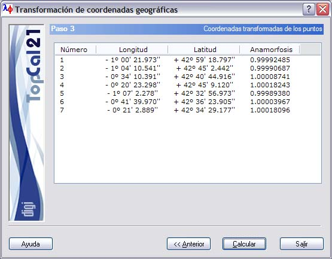
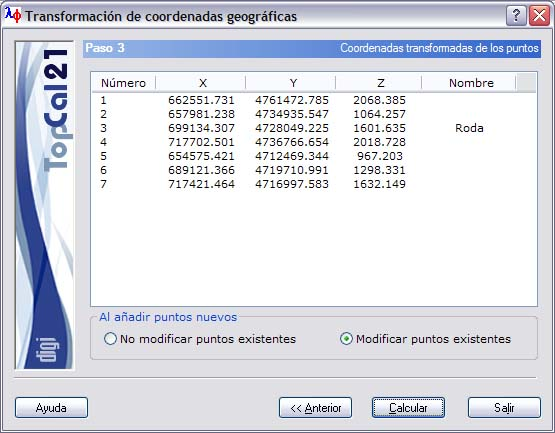

# Paso 3: Coordenadas transformadas de los puntos
<!-- id: topcal21-transformacion-de-coordenadas-geograficas-paso-3-coordenadas-transformadas-de-los-puntos -->

Este es el tercer y último paso en el cálculo de la transformación.

Si la transformación seleccionada en el [paso 1](paso-1-introducir-tipo-de-transformacion.md) fue *Transformar geográficas*, se muestra una pantalla con las coordenadas de los puntos seleccionados en el paso anterior, referidos al sistema de referencia del archivo de puntos actual. Este listado contiene los siguientes campos:

* **Número de punto**
* **Coordenadas del punto**
* **Nombre del punto**

A la hora de añadir los puntos transformados al archivo de puntos actual, se podrá seleccionar *No modificar puntos existentes* o *Modificar puntos existentes* que tengan el mismo número.

Si la transformación seleccionada en el [paso 1](paso-1-introducir-tipo-de-transformacion.md) fue *Generar geográficas*, se muestra una pantalla con las coordenadas geográficas de los puntos seleccionados en el paso anterior. Este listado contiene los siguientes campos:

* **Número de punto**
* **Longitud**, en grados sexagesimales
* **Latitud**, en grados sexagesimales
* Si la proyección del archivo actual es UTM se mostrará la **Anamorfosis lineal** de la proyección en este punto. Si no, se mostrará la **Altitud** del punto.

Una vez que se hayan configurado los datos de salida, se podrá terminar el proceso pulsando el botón **Calcular** o volver al paso anterior [Paso 2: Selección de puntos a transformar](paso-2-seleccion-de-los-puntos-a-transformar.md) pulsando el botón **Anterior**.
