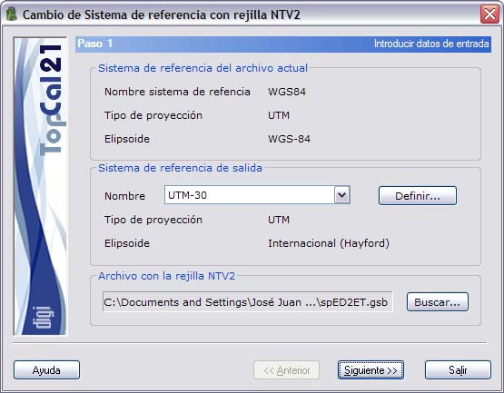

# Paso 1: Introducir datos de entrada
<!-- id: topcal21-transformacion-de-coordenadas-utilizando-rejilla-ntv2-paso-1-introducir-datos-de-entrada -->

En el primer paso para el Cambio de sistema de referencia utilizando rejilla NTV2, se muestran los sistemas de entrada y de salida y el archivo que contiene la rejilla.

El sistema de referencia de entrada corresponde con el definido para el archivo actual que se va a transformar.

El sistema de referencia de salida se puede elegir de la lista disponible al efecto.

Seleccione sistemas de referencia de entrada y de salida que coincidan con los definidos en la cabecera de la rejilla NTV2. Para conocer los sistemas definidos en esa cabecera, avance hasta el Paso 2.

Si el sistema de referencia deseado no está disponible en la lista se puede pulsar el botón **Definir** para crear uno nuevo. El programa, entonces, mostrará el cuadro de diálogo [Sistemas de referencia](../../otros-comandos/sistemas-de-referencia/listado-de-sistemas-de-referencia.md).

Por último, se deberá indicar el archivo que contiene la rejilla NTV2. En la instalación de TopCal 21 se proporciona una rejilla para transformaciones entre los sistemas ED-50 y ETRS-89 válida para España. Este archivo se instala en la misma carpeta en la que se haya instalado el programa y se llama "spED2ET.gsb".

Una vez introducidos estos datos se podrá pulsar el botón **Siguiente** para acceder al [Paso 2: Configurar modo de cálculo](paso-2-configurar-modo-de-calculo.md).
