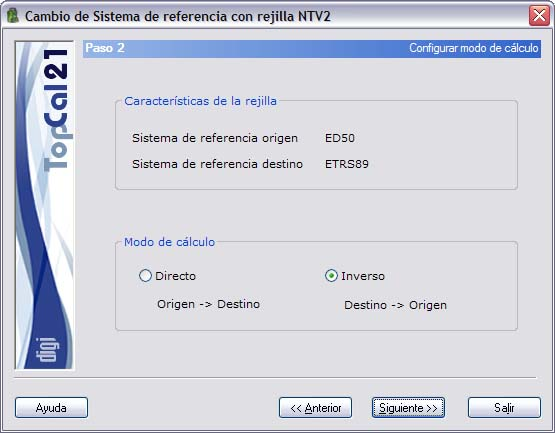

# Paso 2: Configurar modo de cálculo
<!-- id: topcal21-transformacion-de-coordenadas-utilizando-rejilla-ntv2-paso-2-configurar-modo-de-calculo -->

Este es el segundo paso para el Cambio de sistema de referencia utilizando rejilla NTV2, en el que se muestran los sistemas de referencia entre los que se pueden transformar coordenadas utilizando el archivo definido en el paso anterior.

Como se ha indicado en el Paso 1 estos sistemas de referencia deberían coincidir con los definidos en los archivos TopCal que se están transformando. Si no, no se realizará un cálculo correcto.

Además, en este paso, se deberá elegir el sentido de transformación de coordenadas:

* **Directo**: Se parte de coordenadas definidas como Origen y se desea llegar a las coordenadas definidas como Destino.
* **Inverso**: Se parte de coordenadas definidas como Destino y se desea llegar a las coordenadas definidas como Origen.

Cuando se haya configurado el modo de cálculo se puede pulsar el botón **Siguiente** para acceder al [Paso 3: Selección de puntos](paso-3-seleccion-de-puntos.md) o volver al [Paso 1: Introducir datos de entrada](paso-1-introducir-datos-de-entrada.md) pulsando el botón **Anterior**.
