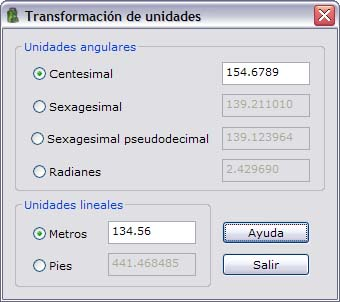

# Transformación de unidades
<!-- id: transformacion-de-unidades -->

Esta herramienta permite transformar valores expresados en una unidad angular o lineal a otra. De esta forma, bastará con indicar la unidad en la que se va a introducir el valor de entrada y el programa calculará el valor transformado en el resto de unidades del mismo tipo de unidad.

Si se transforman unidades angulares se podrá optar entre:

* *Centesimal*: Ángulos cuyo círculo completo tiene 400 grados.
* *Sexagesimal*: Ángulos cuyo círculo completo tiene 360 grados.
* *Sexagesimal pseudodecimal*: Ángulos cuyo círculo completo tiene 360 grados, pero en el que los dos primeros dígitos tras el separador decimal representan los minutos, los dos siguientes representan los segundos y los restantes representan los decimales de los segundos.
* *Radianes*: Ángulos cuyo círculo completo equivale a 2π radianes.

Si se transforman unidades lineales se podrá optar entre:

* *Metros*
* *Pies*

Para utilizar esta herramienta no es necesario tener abierto ni activo ningún tipo de documento.

